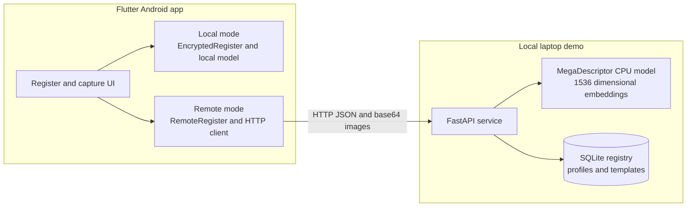

# MuzzIID

MuzzIID is a Flutter Android cattle register prototype. It has two separate operating modes:

- **Local mode** is the existing offline register. It stores encrypted records on the device and uses the bundled ResNet50 ONNX research embedding model where configured.
- **Remote demo mode** sends muzzle images to a laptop running a CPU-only MegaDescriptor service. The laptop owns the authoritative registry and performs all remote comparisons. This mode is optional and intended for controlled research demonstrations.

The interface uses Material 3 with the existing cream-and-green design. The local register supports saved-offline workflows, structured vaccinations, English and Luganda, and guided five-frame enrollment. Enrollment captures five quality-approved frames and issues a local receipt. The remote mode is opt-in at build time and does not sync with or compare against local-mode templates.

The stack uses Flutter and Dart, Riverpod state management, GoRouter navigation, the existing Android camera and ONNX runtime, encrypted local storage, and a standard-library Dart HTTP client. The new backend uses Python, FastAPI, PyTorch, timm, Pillow, NumPy and SQLite. It does not train or fine-tune the model.

## Architecture



Remote mode is selected with the `REMOTE_BIOMETRICS` Dart define. The Android client reads and writes records through `/animals`, `/enroll`, profile updates, vaccination routes, and deletion routes. It submits a single cropped image for recognition. The backend creates embeddings, maintains normalized five-image enrollment templates, ranks cosine similarities, and returns profile and vaccination data only for an accepted result. This is a prototype transport, not a production service.

## Local mode

Install Flutter stable and the Android SDK, connect an Android handset with USB debugging enabled, then run:

```sh
cd muzzlid
flutter pub get
flutter run
```

The validation script locates configured Flutter and ADB installations and selects the sole connected device, or accepts an explicit device ID:

```sh
cd muzzlid
./tool/test_android.sh
# Or: ./tool/test_android.sh YOUR_DEVICE_ID
```

The local workflow and model are documented in [model integration](docs/MODEL_INTEGRATION.md), [training provenance](model_training/README.md), [measured results](model_training/report.json), and [Android validation](docs/ANDROID_VALIDATION.md).

## Remote CPU demo

### Requirements and model files

The backend requires Python, a CPU-compatible PyTorch and torchvision pair, timm, FastAPI, Uvicorn, NumPy, Pillow, httpx, and pytest. The Android side requires Flutter, Android SDK platform tools, a USB-connected device with USB debugging, and an ADB reverse tunnel for a physical phone. MegaDescriptor-L-384 has a large checkpoint and is CPU intensive. The first real image embedding is slow on a laptop CPU.

The existing environment in this checkout is `.venv`. No dependency or model download is performed automatically. If you need a new environment, these are the optional setup commands. Review PyTorch's platform-specific installation instructions and select matching CPU builds for your OS before using the requirements file.

```sh
python3 -m venv .venv
.venv/bin/python -m pip install -r demo_backend/requirements.txt
```

The backend expects the already available `config.json` and `pytorch_model.bin` in `/home/kelvin/Models/MegaDescriptor-L-384`. Do not download or replace them for this demonstration.

The default model directory is `/home/kelvin/Models/MegaDescriptor-L-384`. Set `MUZZLID_MODEL` to another directory if needed. The loader checks the Swin-L architecture and 1536 feature size, then loads the checkpoint strictly. The model code applies a 384 by 384 resize, RGB conversion, mean and standard deviation of 0.5, and L2 normalization. A model version contains the checkpoint digest and preprocessing identifier, and is stored with each registry template.

**License and use constraint:** The MegaDescriptor [model card](https://huggingface.co/BVRA/MegaDescriptor-L-384) declares CC BY-NC 4.0. The repository's `config.json` also contains an MIT metadata field, but that does not override the model card's non-commercial license for the checkpoint. Treat the weights as non-commercial unless the rights holder grants separate permission. Review all upstream terms before redistribution or commercial use. The cattle dataset has a separate CC BY 4.0 attribution requirement documented in [training provenance](model_training/README.md).

### Paths and configuration

Paths and environment variables are local-demo defaults. Set them explicitly for each run:

| Setting | Default | Purpose |
| --- | --- | --- |
| `MUZZLID_MODEL` | `/home/kelvin/Models/MegaDescriptor-L-384` | Model directory containing configuration and checkpoint |
| `MUZZLID_DB` | `demo_backend/registry.sqlite3` | SQLite file for cattle, templates, image hashes, and vaccinations |
| `MUZZLID_POLICY` | unset | Optional calibration JSON. It must contain a matching `model_version` and a `policy` object. |
| `MUZZLID_THREADS` | `4` | PyTorch CPU thread count |
| `BACKEND_URL` | `http://127.0.0.1:8000` | Android remote-mode URL, supplied as a Dart define |
| `REMOTE_BIOMETRICS` | `false` | Enable the remote repository and capture flow, supplied as a Dart define |

Use a dedicated SQLite path for every evaluation or manual demo. Do not point test runs at a working registry. The backend creates its tables on startup and refuses to open a registry whose stored model version differs from the active checkpoint. Back up or remove only a disposable demo database when resetting a demo.

With no `MUZZLID_POLICY`, the backend intentionally returns `uncertain` whenever the registry is non-empty. An empty registry returns `unknown`. A calibrated policy can return `accepted` only above its acceptance threshold and top-two margin, `uncertain` for borderline or ambiguous scores, and `unknown` below its rejection threshold. Similarity is a cosine score, not a probability. Enrollment rejects repeated photographs and blocks any existing identity whose match is not confidently unknown. Review duplicate conflicts manually.

### Start the laptop service

Run from the repository root with a dedicated database. The completed calibration has no supported policy. Explicitly unset `MUZZLID_POLICY`:

```sh
env -u MUZZLID_POLICY MUZZLID_DB=demo_backend/http_evaluation.sqlite3 \
.venv/bin/uvicorn demo_backend.app:app --host 127.0.0.1 --port 8000
```

The saved calibration report has `policy: null`; setting `MUZZLID_POLICY` to it correctly prevents startup. In that state, results for registered animals remain `uncertain` by design. Check service readiness in another terminal:

```sh
curl http://127.0.0.1:8000/health
curl http://127.0.0.1:8000/animals
```

The API also provides `POST /enroll`, `POST /recognize`, `GET /animals/{id}`, `PATCH /animals/{id}`, `POST /animals/{id}/vaccinations`, and `DELETE /animals/{id}`. Enrollment accepts exactly five base64 encoded photographs and requires `id`, `owner`, and `created` fields. Recognition accepts one photograph. The service limits each encoded image to 16 million characters, validates embedding shape and values, and stores normalized templates and SHA-256 image hashes in SQLite.

### Run remote mode on a Samsung phone

For a physical phone connected by USB, forward its localhost port to the laptop service, then start Flutter with the remote defines:

```sh
adb devices
adb reverse tcp:8000 tcp:8000
cd muzzlid
flutter run --dart-define=REMOTE_BIOMETRICS=true --dart-define=BACKEND_URL=http://127.0.0.1:8000
```

The debug Android configuration permits cleartext traffic only for localhost and `127.0.0.1`. The main manifest adds Internet permission without enabling cleartext. Do not expose this service to a public or untrusted network. The demo has no authentication, authorization, TLS, request signing, rate limiting, durable audit trail, or production privacy controls. USB reverse mode is for a trusted local development connection only.

To manually rehearse the phone flow:

1. Start the laptop server with a new disposable database and confirm `/health` responds. On an empty database recognition should report `unknown`.
2. Connect the Samsung by USB, run `adb reverse tcp:8000 tcp:8000`, and launch the remote build above. The current checkout detected a Samsung SM-S901U and completed `adb reverse`; a full remote phone session has not yet been verified.
3. In the app, open **Enrol animal**, enter a fictional owner and other clearly fictional demo details, then capture five frames. The remote capture flow offers **Gallery** as an alternative. It opens the Android document picker once per image and presents a crop screen for each frame.
4. Save the enrollment and check that the laptop `/animals` route contains the profile. Add only fictional vaccination details during a demo. The backend will return a conflict if the five images are duplicates or look too similar to an enrolled identity.
5. Open **Verify animal**, complete the acknowledgement check, then capture and crop one muzzle image or choose it from Gallery. An accepted result can open the returned profile and vaccinations. An uncertain result shows the score and no animal details.
6. Try a different animal image and, if useful, a printed or screen-displayed photograph. The remote mode has no liveness check, so a printed image may be accepted by the model. Record the actual outcome and do not treat it as proof of identity.
7. Stop and restart the backend with the same database and model settings. Confirm `/animals` retains each enrolled identity and its fictional vaccinations. Persistence is covered by deterministic backend tests; a real-model restart trial remains NOT TESTED.
8. Stop the backend while the app is open and attempt identification. Expect an error and retry control, with no substituted local identity. Restart the backend and retry. Phone behavior remains NOT TESTED until confirmed.

For a reproducible Cow A/B/C trial, use `cattle_0100`, `cattle_0200`, and `cattle_0300` respectively. Each folder contains one animal. The manifest selects five enrollment files and two separate probes for each. Counts observed were A: 8, B: 10, C: 17, all selected files decoded as JPEG. Copy only selected images to the phone with this user-run command from the repository root:

```sh
.venv/bin/python - <<'PYCODE'
import json
import subprocess
from pathlib import Path
root = Path('/home/kelvin/Downloads/BeefCattle_Muzzle_database/BeefCattle_Muzzle_Individualized')
for item in json.loads(Path('demo_backend/selection.json').read_text())['samples']:
    destination = '/sdcard/Download/MuzzlD/' + item['animal'] + '/' + item['role']
    subprocess.run(['adb', 'shell', 'mkdir', '-p', destination], check=True)
    subprocess.run(['adb', 'push', str(root / item['path']), destination + '/'], check=True)
PYCODE
```

In Gallery, select five A enrollment files in order, using the whole image crop for the first original-file trial. Label the owner `FICTIONAL DEMO OWNER A`. Verify each A probe separately, then repeat for B. Scan C's first probe before enrolling C. A supported policy should accept genuine probes and reject C; record uncertain results, genuine rejections, and any false acceptance as observed failures. Do not change thresholds to make these animals pass. Enroll C with its five reserved enrollment files and test its second probe. Retry enrollment with A's same files to check the duplicate conflict. Verify the accepted ID and its specific fictional vaccination record, rather than relying on the displayed score.

For printed-photo trials, print only the selected original images, retain their file labels and roles, avoid glare, and use the existing camera guide. Crop out the paper border while retaining the muzzle. Keep probes separate from enrollment photographs. These trials require Samsung operation and remain NOT TESTED. They do not establish spoof resistance or reliable unknown rejection.

Gallery and cropping are implemented, but manual phone HTTP, gallery selection, cropping, and printed-photo behavior have not yet been verified. The first Android debug build failed on Flutter/Gradle version validation; the corrected configuration still needs a build.

### Current Samsung test with acceptance disabled

Complete the HTTP and restart checks first. Then stop that server and use a separate empty phone database, leaving the HTTP evaluation database intact:

```sh
env -u MUZZLID_POLICY MUZZLID_DB=demo_backend/phone_demo.sqlite3 \
.venv/bin/uvicorn demo_backend.app:app --host 127.0.0.1 --port 8000
```

On the Samsung, enroll A with its five enrollment photographs and a clearly fictional owner. Confirm POST `/enroll` returns 201 in laptop logs. Probe A with its held-out image and C with its initially unknown probe: both should return `uncertain` without a matched identity under the present policy. A successful HTTP response confirms transport and real inference only. It does not verify known recognition or unknown rejection. Do not open a different animal profile for these scans.

Open A explicitly from the Register to inspect its metadata, add a fictional vaccination, and confirm it in GET `/animals/{id}` and after restart. This is manual record retrieval, not accepted biometric profile retrieval. Retry A enrollment to observe a duplicate conflict. B/C enrollment may be blocked conservatively; stop rather than bypassing that guard. Accepted-match profile retrieval and enrolling/recognizing C within a populated registry remain blocked until a supported policy exists. Every physical step is NOT TESTED until confirmed by the user and server logs.

For local ResNet50 compilation, the independent command from `muzzlid` is `flutter build apk --debug --no-pub --dart-define=REMOTE_BIOMETRICS=false`. Preserve that APK if needed, then build the remote mode using the command below. The original local ONNX inference path and encrypted local registry are unchanged. Actual Samsung local-mode regression behavior still needs device verification.

### Dataset split, calibration, and HTTP evaluation

The deterministic manifest is [selection.json](demo_backend/selection.json). It uses the lexical first seven images for each of three identities: five enrollment images and two held-out probes. The third identity is reserved as an initially unknown animal, then is enrolled after unknown probes. The script checks exact file and decoded-pixel duplicates. These three demonstration identities are excluded from development calibration.

Future calibration requires eight other identities, with five images per identity for templates and two separate probes. The completed calibration used three-image templates, which differs from the deployed five-image protocol. That report is preserved as a diagnostic and is not an operational calibration. The loader now requires a matching `five-image-mean-l2-v1` calibration protocol before loading any future supported policy. It chooses thresholds using development impostor and genuine scores and writes a model-version-bound report. Eight identities are not enough for reliable field unknown rejection. If development scores overlap or the fixed margin is not supported, no policy is exported. Do not tune thresholds on the three demonstration identities or present this small development calibration as a field guarantee.

The scripts can take a long time because they embed many full-resolution dataset images on CPU. Run them manually from the repository root and allow them to finish. The default data location is `/home/kelvin/Downloads/BeefCattle_Muzzle_database/BeefCattle_Muzzle_Individualized`; provide `--dataset` if the dataset is elsewhere.

```sh
# Future five-image development calibration, not required for the next HTTP checks.
# Preserve the completed diagnostic report by using a separate output.
.venv/bin/python -m demo_backend.evaluate calibrate \
  --output demo_backend/calibration_five_image.json

# Start a clean, dedicated database for the HTTP evaluation in another terminal.
env -u MUZZLID_POLICY MUZZLID_DB=demo_backend/http_evaluation.sqlite3 \
.venv/bin/uvicorn demo_backend.app:app --host 127.0.0.1 --port 8000

# Optional real HTTP evaluation. It requires an empty dedicated database.
.venv/bin/python -m demo_backend.evaluate http \
  --url http://127.0.0.1:8000 \
  --output demo_backend/evaluation.json
```

Keep `MUZZLID_POLICY` unset for the current failed report. Any future supported policy must match both the model version and five-image enrollment protocol. The HTTP evaluator refuses a non-empty database to avoid deleting or overwriting an existing demo registry. Calibration excludes decoded-pixel duplicates of the selected demonstration images from development calibration. The HTTP evaluator records actual decisions and identities in JSON, marks expected outcomes as pass or fail, and exits nonzero when an expected decision fails. The completed development calibration failed to support a policy. The first real HTTP evaluation completed with 4 PASS and 5 FAIL outcomes, detailed below. With acceptance disabled, known probes and Cow C are expected to be uncertain; this is not successful recognition or unknown rejection. Later enrollment can be blocked as a possible duplicate, so C-after-enrollment recognition may remain NOT TESTED.

### Real HTTP persistence verification

After the first HTTP evaluation finishes, stop Uvicorn with Ctrl+C and restart using exactly the same `MUZZLID_DB` command above. Wait for `Application startup complete`, then run from the repository root:

```sh
.venv/bin/python -m demo_backend.evaluate http-restart
```

This verifies a new backend instance ID, unchanged model and policy, persisted animal profiles and vaccination records, and a real re-extracted A probe score against the persisted template. It writes `restart_verification` into the existing evaluation report and fails if the server was not actually restarted. It does not delete records or rerun enrollment. A persistence PASS does not turn a biometric FAIL into a successful recognition.

### Investigating scores and rank-1 without changing thresholds

The completed HTTP run had only A in its registry, so it cannot establish rank-1 performance among several cattle. The diagnostic command below uses the real model offline and does not enroll records, export a policy or enable acceptance. Run it manually because inference may take minutes:

```sh
.venv/bin/python -m demo_backend.diagnose
```

Expected result: `demo_backend/diagnostics.json`, containing original calibration-protocol reproduction; per-probe scores, wrong rank-1 identities and margins; a controlled three-versus-five-image comparison on identical separate sixth/seventh probe images; A/B/C closed-set rankings; and C scores against A/B. It also compares A's rebuilt five-image template to the stored registry template and checks reproduction of the first HTTP A probe score. Version-bound local embedding caches avoid repeating image inference on later runs. The first run must extract embeddings because previous reports did not retain them. Stop other CPU inference workloads first if practical, then restart FastAPI for phone tests.

The production preprocessing remains EXIF-corrected RGB, bilinear resize to 384 by 384, conversion to a tensor, mean/std 0.5 normalization, image-vector L2 normalization and a final L2-normalized mean of five image vectors. Resize and normalization follow the [publisher's example](https://huggingface.co/BVRA/MegaDescriptor-L-384#image-embeddings). The bundled config describes different ImageNet normalization and center cropping; it is not silently substituted. Rank-1 diagnostics cannot certify open-set rejection. No diagnostic result is available yet; neither threshold relaxation nor training is performed.

### Build repair and next manual checkpoints

The corrected pins are Gradle 9.3.1 and AGP 9.1.1, matching the installed Flutter validator and the [AGP compatibility requirements](https://developer.android.com/build/releases/agp-9-1-0-release-notes?hl=en). The wrapper's binary ZIP checksum comes from [Gradle's checksum reference](https://gradle.org/release-checksums/). The app uses AGP built-in Kotlin; its separate unapplied Kotlin plugin declaration and all Flutter package locks remain unchanged. Do not bypass dependency validation for this check.

USER ACTION REQUIRED

1. Restart FastAPI in **terminal A** from the repository root and leave it running:

   ```sh
   env -u MUZZLID_POLICY MUZZLID_DB=demo_backend/http_evaluation.sqlite3 .venv/bin/uvicorn demo_backend.app:app --host 127.0.0.1 --port 8000
   ```

   Purpose: reopen the already populated evaluation registry. Wait for `Application startup complete`. Do not rerun `evaluate http`, which correctly requires an empty registry.

2. In **terminal B**, from the repository root:

   ```sh
   curl -fsS http://127.0.0.1:8000/health
   .venv/bin/python -m demo_backend.evaluate http-restart
   ```

   Expected result: a new backend instance ID and a persistence PASS if the saved profile, vaccination and probe score match. Keep terminal A running throughout this command. A model startup delay is not a failed persistence check.

3. Build from `muzzlid`:

   ```sh
   flutter build apk --debug --no-pub --dart-define=REMOTE_BIOMETRICS=true --dart-define=BACKEND_URL=http://127.0.0.1:8000
   ```

   Purpose: build the Android remote client with supported Gradle/AGP pins. This manually initiated operation will download the uncached Gradle 9.3.1 binary distribution and may download AGP/dependencies. Expected result: `build/app/outputs/flutter-apk/app-debug.apk`. Return any new failure output; no package upgrade command has been run by the agent.

4. After a successful build, while FastAPI is ready, install and launch from `muzzlid`:

   ```sh
   adb reverse tcp:8000 tcp:8000
   adb install -r build/app/outputs/flutter-apk/app-debug.apk
   adb shell am start -n com.example.muzzlid/.MainActivity
   ```

   Confirm the remote demonstration label, A's fictional owner in Register and a corresponding GET `/animals` in the laptop server log after launch. Then select an unseen A probe from Gallery and confirm a new POST `/recognize` with HTTP 200 plus the actual phone score/decision. This confirms phone-to-real-backend communication only when both phone behavior and server logs are observed. Expected current decision is uncertain, with no matched profile button. Do not claim successful biometric identification.

For physical enrollment use the separate phone database procedure above. Preserve the evaluation registry for persistence testing. Accepted biometric profile retrieval and reliable unknown rejection remain unavailable with the failed calibration.

### Rebuild the image selection manifest

The checked-in manifest is deterministic and can be regenerated if the dataset file set changes. The current script's default dataset path is local to the original development machine. Edit `ROOT` in `demo_backend/selection.py` to the dataset directory before invoking the script if that default is unavailable. This command overwrites the manifest:

```sh
.venv/bin/python -m demo_backend.selection
```

## Validation status

- The deterministic FastAPI suite passes: `.venv/bin/python -m pytest demo_backend/test_api.py -q` covers deterministic API behavior using a fake 1536 dimensional engine. The expanded `.venv/bin/python -m pytest demo_backend -q` suite now reports 23 passed and 1 skipped, including diagnostic metrics, connection errors and blocked-enrollment CPU checks. These unit tests do not establish real biometric accuracy.
- An optional real-model test can be enabled with `MUZZLID_REAL_TEST=1 .venv/bin/python -m pytest demo_backend/test_real_model.py -q`. It exercises the real checkpoint and is skipped by default. The latest backend run passed 23 tests and skipped this opt-in real-model test. Real inference was separately observed in calibration and HTTP evaluation.
- The Flutter suite passes: from `muzzlid`, run `flutter test --no-pub test`. The current observed run passed 14 tests, including 2 network tests.
- Python compilation via `compileall` passed in the observed run.
- `flutter analyze` completed with informational deprecation and style notices only in the observed run. Review current analyzer output before release.
- A real MegaDescriptor checkpoint load and first genuine dataset embedding completed on CPU; the observed first embedding took about 89.8 seconds and returned 1536 finite values with norm 1.
- Samsung SM-S901U device detection and `adb reverse` succeeded.
- Development calibration completed with real MegaDescriptor embeddings: minimum genuine score `0.4274407625`, maximum impostor score `0.6420065165`, minimum genuine margin `-0.0235794485`. **FAIL: no supported acceptance/unknown-rejection policy.** No thresholds were relaxed.
- An independent audit of all 61 selected development/demo files found unchanged SHA-256 hashes, no exact file or orientation-normalized pixel duplicates, and disjoint development/demo identities. Near-duplicate frames, capture-session dependence and overlap with model pretraining remain unresolved. Only 16 development probes were evaluated. The old calibration used three enrollment images per template; deployment uses five. Impostor comparisons among development identities do not establish field open-set reliability.
- The real HTTP evaluation completed: **4 PASS / 5 FAIL**, exit code 1. Empty registry handling, A enrollment, duplicate A blocking and corrupt-image rejection passed. A's two genuine probes returned `uncertain` at `0.7739304900` and `0.6829597950`. Unenrolled C returned `uncertain` at `0.2275747359`, not `unknown`. No identity was disclosed for these unaccepted matches. B and C enrollment returned 409 because calibration was unavailable, not because a biometric duplicate was established. C-after-enrollment recognition is NOT TESTED. The script fetched A's profile and checked its fictional vaccination, but accepted biometric profile retrieval has not passed.
- A read-only database inspection after shutdown confirmed A's stored 1536-dimensional finite template has norm 1, with one vaccination record. This confirms committed data on disk. The restart evaluator was run while the server was stopped and failed with connection refused, so real backend restart/template verification remains NOT TESTED. The evaluator now persists an actionable NOT TESTED result instead of printing that connection-error traceback.
- Android debug compilation **FAIL**: the installed Flutter 3.50.0 requires Gradle 9.3.1 or newer; the project used 9.1.0. Its local validator also requires AGP 9.1.1. Wrapper and AGP pins are prepared at those minimum versions; the Gradle binary archive checksum is pinned. No distribution or plugin was installed automatically. Corrected build, phone HTTP, gallery/cropping and printed-photo workflows remain NOT TESTED.

The Nokia local-mode validation reported in [Android validation](docs/ANDROID_VALIDATION.md) passed the Android runner, including encrypted workflows, CameraX/GPS, ONNX inference, and isolated enrollment, matching, and cache checks. It does not certify the remote backend or the phone workflows listed above. Local device screenshots, records, exports, environments, and build outputs are excluded from this repository.

## User-run build and verification checkpoints

Remaining operations may take minutes or need phone interaction and are user-run. The calibration and first HTTP evaluation are already complete. No packages, models or datasets were installed or downloaded automatically.

1. Calibration already completed and failed to support a policy. Do not repeat it for this checkpoint. Keep acceptance disabled and unset `MUZZLID_POLICY`.
2. Optionally run `MUZZLID_REAL_TEST=1 .venv/bin/python -m pytest demo_backend/test_real_model.py -q`. Purpose: repeat strict real checkpoint and genuine photograph validation as an automated test. Success indicator: one passed test. This is separate from the direct real embedding check already completed.
3. The first `.venv/bin/python -m demo_backend.evaluate http` run is complete; do not repeat it against the populated registry. Resume with `http-restart` as described above.
4. From `muzzlid`, run `flutter build apk --debug --no-pub --dart-define=REMOTE_BIOMETRICS=true --dart-define=BACKEND_URL=http://127.0.0.1:8000`. Purpose: compile the Android remote client. Success indicator: `build/app/outputs/flutter-apk/app-debug.apk`. If Gradle requires a download, stop and report it before installing dependencies.
5. Run `adb install -r build/app/outputs/flutter-apk/app-debug.apk`, then `adb reverse tcp:8000 tcp:8000` and `adb shell am start -n com.example.muzzlid/.MainActivity`. Purpose: run on Samsung without uninstalling the existing application or clearing its local records. Success indicator: remote demonstration label, successful backend registry loading, and requests appearing in server logs. This is NOT TESTED until the phone session is confirmed.


## Troubleshooting

| Symptom | Check and action |
| --- | --- |
| Camera unavailable | Grant Camera permission in Android Settings, close other camera apps, then retry. Remote Gallery remains an alternative. Local GPS requirements remain in force. |
| Phone missing or unauthorized in ADB | Use a data cable, enable USB debugging, unlock the phone and accept its debugging prompt. Run `adb devices -l`; expect one authorized `device`. |
| App cannot reach backend | Confirm `/health` works on the laptop, rerun `adb reverse tcp:8000 tcp:8000` after reconnecting, and check `adb reverse --list`. Android localhost refers to the phone until forwarding is active. |
| Timeout | First model load plus one inference took about 90 seconds here. Wait for Uvicorn startup completion before opening the app. Requests time out after 120 seconds; check logs and registry before retrying enrollment because a timed-out server operation may still commit. |
| Model missing or incompatible | Check both files under `MUZZLID_MODEL`, architecture, 1536 features and checkpoint integrity. Inspect startup logs. No random-weight fallback is used. |
| Registry or policy model mismatch | Use the matching checkpoint and transform, or a separate new disposable database. Recalibrate for any preprocessing or checkpoint change. Preserve working registries. |
| All scans uncertain or later enrollments conflict | Check `/health` and whether a supported policy loaded. With no policy, every nonempty comparison is uncertain and further enrollments are conservatively blocked as possible duplicates. |
| Invalid image | Select a decodable image below the 12 MB Android picker limit and backend 25 megapixel limit. Use five distinct photographs for enrollment. |
| HTTP blocked on Wi-Fi | `BACKEND_URL` is configurable, but debug cleartext is allowed only for loopback. Wi-Fi HTTP requires adding the exact development host to the debug-only XML configuration. HTTPS is preferable. USB is the verified forwarding setup. |
| Flutter or Gradle asks to download | Stop and run the explicit dependency or build command manually after reviewing it. Do not update `pubspec.lock` or upgrade dependencies to resolve this automatically. |

## Security, licensing, and limitations

Remote mode sends cropped biometric images and owner or veterinary records as plain HTTP JSON through a localhost USB reverse tunnel. SQLite stores records and biometric templates without encryption. The service is unauthenticated and intended only for an isolated, trusted development laptop and fictional demo records. Do not bind it to a public interface, use it for real animal or owner decisions, or treat a cosine score as probability or evidence of liveness.

The MegaDescriptor checkpoint is labeled CC BY-NC 4.0 by its model card. The config's MIT metadata is not a substitute for those checkpoint terms. The dataset is separately licensed CC BY 4.0. Confirm permissions and attribution obligations before use or redistribution. This prototype does not establish legal permission for commercial use.

Field accuracy, open-set rejection rates, thresholds, phone networking, image capture quality, liveness, spoof resistance, privacy controls, and veterinary record correctness are not certified. Camera captures are not proof of freshness, and printed images are accepted as ordinary input. Any real deployment would require representative cattle data, independent validation, consent and privacy design, security controls, auditability, operational review, and human confirmation.

## Future work

- Resolve the failed calibration with a representative five-image protocol and independent unknown identities, then complete real HTTP evaluation without tuning to the demonstration animals.
- Build and install the remote Android debug app, then verify phone HTTP, gallery selection, crop orientation, and printed-photo behavior on-device.
- Evaluate with more cattle, farms, breeds, lighting, poses, devices, and attack conditions before selecting any operating threshold.
- Add authentication, TLS, authorization, encrypted storage, retention controls, audit logging, and reviewed data handling before any networked deployment.
- Resolve the upstream model checkpoint license and config metadata questions with the rights holder before considering non-demo use.
- Design safe duplicate review and veterinary data workflows with domain experts. Keep uncertain matches hidden from the UI and require human review.

## Project layout

- `muzzlid/`: Android app, domain, local and remote data layers, presentation screens, tests, and bundled local-mode model.
- `demo_backend/`: CPU-only FastAPI demonstration, model loader, deterministic image manifest, calibration and HTTP evaluation scripts, and backend tests. Model weights, local registries, and generated reports are excluded from Git.
- `model_training/`: baseline training and export scripts, split manifest, attribution, and measured results. Downloaded images, caches, and checkpoints are excluded from Git.
- `docs/`: implementation, model handoff, specification, and Android validation documents.
- `files/`: UI references.
- `literature review/links.txt`: research sources. Third-party repository copies and archives are not vendored.

The original Word specification is included. Later user-approved client changes are recorded in the current documentation.

## Local model and research results

The bundled local-mode baseline was trained using 4,823 public muzzle images from 248 cattle, with separate training, calibration, and test identities. It ranked the correct identity first on 95.06% of 627 held-out probes. This is a research baseline. Field accuracy, the specification's false-match target, liveness, and ownership verification are not certified. Research results require manual confirmation.

See [model integration](docs/MODEL_INTEGRATION.md), [training provenance](model_training/README.md), [measured results](model_training/report.json), and [Android validation](docs/ANDROID_VALIDATION.md).
